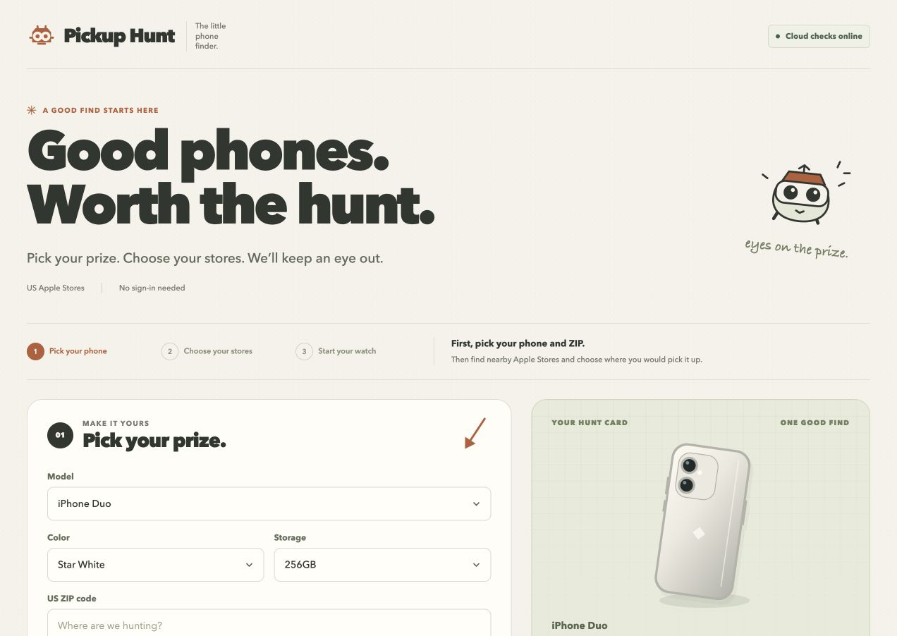
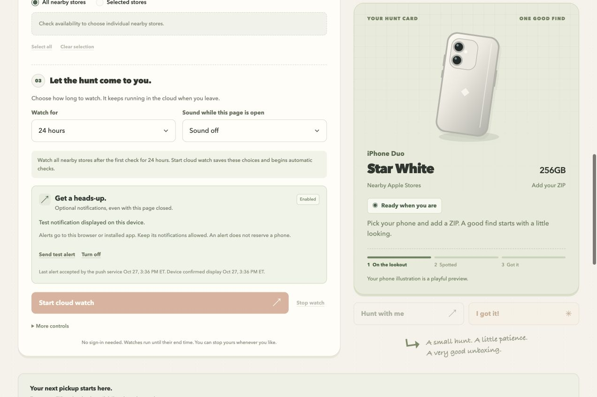

# Pickup Hunt

**Good phones. Worth the hunt.**

A playful iPhone pickup finder built by Shane Windt with Codex. Choose a model, color, storage, ZIP code, and Apple Stores. Start a cloud watch and let a background notification bring you back when the phone is spotted.

[Try the live app](https://pickup-hunt.dreaminpixels.chatgpt.site/) · [Read the case study](docs/CASE_STUDY.md)

[](https://github.com/EATS-spec/pickup-hunt/actions/workflows/ci.yml)



## From one phone to a reusable tool

This started as a launch-day search for one phone. A sister needed a different configuration, and the script became a configurable public app. The case study follows that progression, including a production notification bug that unit tests initially missed.

## What it does

- Select an exact iPhone configuration and nearby stores, with a clear three-step setup.
- Keep a 1–72 hour watch running in the cloud while the page is closed.
- Share inventory work between identical product-and-ZIP searches, with a durable request gate and backoff.
- Send opt-in encrypted Web Push, with retries, deduplication, a test alert, and a separate device display receipt.
- Share hunt preferences with a friend. Confirm a find, stop the watch, and download a victory card.
- Label stale observations and keep unsaved choices separate from the saved target.

Checkout happens at Apple. Pickup Hunt collects no Apple account credentials or payment information.

## Run locally

Requires Node.js 22.13 or newer and npm.

```sh
npm ci
npm run db:migrate
npm run dev
```

Open the local URL printed by the server. The development database lives under the ignored `.wrangler/state/` directory. These commands initialize an empty database; they do not copy saved hunts or contact the live demo's updater.

For optional local push/updater configuration, copy `.dev.vars.example` to `.dev.vars` and fill in your own values. Without push keys, the finder still loads and explains that notifications are unavailable. Apple can refuse requests from a development machine; the interface reports failures without presenting them as fresh stock.

```sh
npm test
npm run build
```

Tests cover SQLite persistence, browser isolation, queue concurrency, backoff, encryption, native Workers requests, display receipts, and the frontend controller. CI runs tests and a production build without Apple credentials or live inventory requests.

## Deploy your own

The live app runs on **Sites**, using a Cloudflare Worker and D1. This is a fresh public source snapshot: live Site identity, credentials, runtime records, and private Git history are excluded. Commits here do not automatically update the live demo.

To deploy through Sites, register a new Site from this source, retain its returned project ID in `.openai/hosting.json`, provision the D1 binding named `DB`, and apply migrations through the normal Sites publishing workflow. Configure your own runtime values in the hosting service:

| Setting | Purpose |
| --- | --- |
| `RATE_SALT` | A random value for hashing short-lived mutation limits. |
| `UPDATER_TOKEN_HASH` or `CALLBACK_TOKEN_HASH` | SHA-256 verifier for a dedicated updater bearer token. |
| `VAPID_PUBLIC_KEY`, `VAPID_PRIVATE_KEY`, `VAPID_SUBJECT` | Your P-256 Web Push keys and HTTPS or mailto contact subject. Public key: uncompressed base64url. Private key: JWK `d` value. |
| `SCHEDULE_CADENCE_MINUTES` | The cadence actually installed; defaults to 60. Set 5 after enabling a five-minute timer. |
| `TRUST_SITES_IDENTITY`, `OWNER_EMAIL` | Optional owner MCP access behind Sites' trusted identity proxy. Enable the flag only when that proxy strips and injects identity headers. |

Generic hosting keeps `TRUST_SITES_IDENTITY=false` and uses bearer authorization. The local Wrangler configuration contains a development-only database ID; an independent production host needs its own D1 binding and deployment configuration.

For unattended checks, install the [Google Apps Script relay](apps-script/README.md) with your own Site origin and callback token. It needs one-time Google authorization and a verified timer run. The live demo uses five-minute callbacks and retains an hourly Sites fallback. [The updater contract](UPDATER.md) explains queue and recovery behavior.

## Notifications on iPhone

Open the site in Safari, choose **Share → Add to Home Screen**, then open it from that icon. Set up the watch and enable notifications in the installed app; it may have separate saved choices from the Safari tab.



## Practical limits

The Apple storefront reader is public but undocumented and can throttle or change. Five-minute timer ticks serve a shared queue and do not guarantee every search a five-minute refresh. Observed availability never reserves a phone.

Watches belong to a browser and do not synchronize across devices. Delivery depends on browser/device permission and connectivity. Closed-page delivery was verified in Chrome on macOS; physical iPhone delivery was not part of that verification. Email and SMS are not implemented.

## Source map

| Location | Responsibility |
| --- | --- |
| `public/`, `app/` | Guided setup, illustrations, sharing, victory cards, and browser notifications. |
| `lib/catalog*.mjs` | Product catalog and public seed; no bundled stock history. |
| `lib/inventory.mjs`, `lib/hunt-service.mjs` | Parsing, watches, shared queue, and durable request gate. |
| `lib/push.mjs`, `public/sw.js` | Private subscriptions, encrypted delivery, and display receipts. |
| `db/`, `drizzle/` | Schema and append-only migrations. |
| `apps-script/`, `test/` | Cloud timer and automated verification. |

After editing markup, run `node scripts/sync-page.mjs`. The build also synchronizes the framework homepage automatically.

## License and credits

Original application code and illustrations are [MIT licensed](LICENSE). Retained third-party code keeps its [upstream notices](THIRD_PARTY_NOTICES.md). The phone art is original illustration, not Apple product photography. Apple and iPhone are trademarks of Apple Inc.; this is an independent project.
