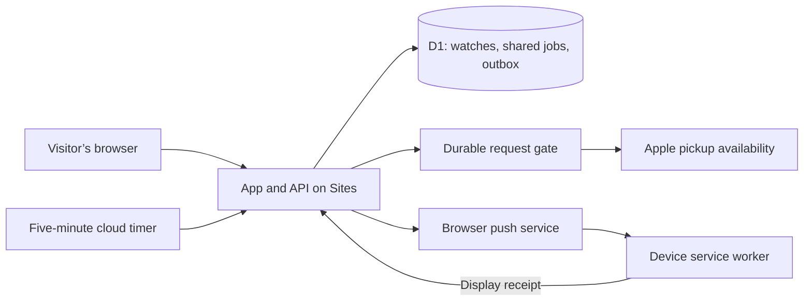

# Pickup Hunt

**From a family launch-day scramble to a public phone finder.**

Built by Shane Windt with Codex · October 2026

[Try the live app](https://pickup-hunt.dreaminpixels.chatgpt.site/) · [Explore the source](../README.md)

## The starting point

Finding a specific iPhone for pickup meant checking the same pages and hoping to catch a short availability window. A local script helped with one launch-day hunt. When a sister wanted a different configuration, adapting the search helped locate another phone.

Both family members reported successful purchases. These are personal reports, not verified order records or a wider success-rate claim.

The useful question became: could anyone set up that search without editing code or leaving a computer running?

## Turning the script into a product

The public version lets anyone choose a phone, ZIP code, and stores, then start a watch. Moving state and checks into the cloud removed the dependency on a particular Mac.

The next release focused on three practical improvements:

- **A clearer first run.** A guided flow separates a one-time stock check from starting an automatic watch. Draft choices stay distinct from the saved target, so changing a color cannot relabel an older result.
- **More frequent unattended checks.** A Google Apps Script timer calls the authenticated updater about every five minutes. An hourly Sites task remains as a fallback.
- **Alerts beyond the open tab.** Visitors can opt into encrypted Web Push, send a test alert, and turn notifications off. The interface distinguishes acceptance by a push service from a device’s confirmation that it displayed the notification.

Warm paper colors, an original scout, shareable hunt preferences, and a victory card keep the hunt light. “I got it!” is a visitor confirmation that stops their watch.

## How it works

Identical product-and-ZIP searches share a job. A durable gate reserves each inventory request before sending it, enforces a minimum gap, and persists backoff when Apple throttles the reader. The queue processes at most one distinct search per tick; five-minute scheduling does not promise a five-minute refresh for every visitor.

Notification delivery uses a private, deduplicated outbox. Before sending, it checks that the subscription and saved watch still apply and that the observation is fresh. Paused, expired, completed, or changed hunts cannot send an old queued stock alert.

No Apple credentials or payment details enter the app. Checkout remains on Apple’s site.

## A production test that mattered

The initial notification implementation passed its tests but failed in the hosted runtime. Cloudflare Workers rejected the sender’s `redirect: 'error'` option. The fix uses `manual` and rejects redirect responses without following them.

A regression test now exercises native Workers request creation, with outbound transport mocked at the service boundary. A mocked JavaScript `fetch` had hidden the difference. Integration review also caught a timestamp captured before slow push delivery; refreshing it preserves the inventory gate’s real request spacing.

The lesson: test the runtime boundary and complete user path alongside isolated functions.

## What was verified

As of October 27, 2026:

- **80 automated tests passed for the hosted release**, covering browser isolation, queue concurrency, backoff, notification encryption, retries, display receipts, and onboarding. The public template passes 82 tests, adding coverage for self-hosted identity defaults and a configurable timer destination.
- A hosted stock check returned **12 store observations**. That is one verification result, not a coverage or stock guarantee.
- An actual scheduled run delivered a test notification after the subscribed Chrome tab was closed. The device’s display receipt was read back afterward.
- Desktop and narrow mobile layouts were checked at 1280 and 351 CSS pixels, with no horizontal overflow.

[View the mobile layout](images/mobile.png)

## The current boundaries

Apple’s pickup reader is public but undocumented and can change or refuse requests. Results carry observation times; stale or failed checks retain their original context. An alert never reserves a phone.

Watches belong to a browser and do not synchronize across devices. iPhone and iPad notifications require adding the app to the Home Screen and setting up the watch there. Closed-page delivery was verified in Chrome on macOS; physical iPhone delivery was not part of this verification. Email and SMS are not implemented.

The next useful extensions are acceptable backup configurations and a durable store availability timeline, with enough observation history to describe patterns responsibly.
